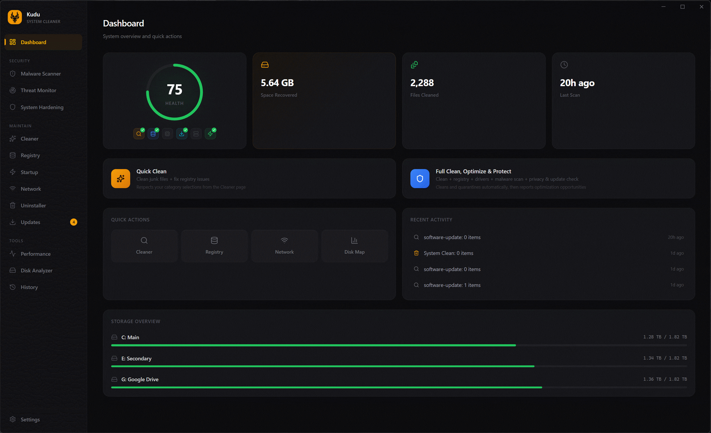

#Очистка #Безопасность #Windows #Инструменты #Privacy

  

<h1 align="center">Kudu</h1>

  <b>Бесплатный open-source системный очиститель и сканер безопасности для Windows, macOS и Linux.</b> 
  Освобождайте место на диске. Удаляйте вредоносное ПО. Возвращайте приватность. Всё в одном приложении.

  
  
  
  
  
  

  <a href="https://github.com/best-radar/bradar-kudu/releases"><b>Скачать</b></a> &nbsp;&middot;&nbsp;
  <a href="CLI.md"><b>CLI Docs</b></a>

---

  

## Скачать

Актуальный установщик для вашей платформы - в [GitHub Releases](https://github.com/best-radar/bradar-kudu/releases):

| Платформа | Формат |
|----------|--------|
| Windows | установщик `.exe` |
| macOS | `.dmg` (Intel и Apple Silicon) |
| Linux | `.AppImage` или `.deb` |

## Почему Kudu?

Большинство системных очистителей - закрытый код, реклама и платные подписки. Иногда это почти маскированное вредоносное ПО.

Десктопные инструменты Kudu - **бесплатные, open-source и прозрачные**. Без рекламы, бандлов и назойливых окон. Сканирование и очистка работают локально; облачные функции подключаются только если вы сами их включите. Можно читать код, проверять каждый скан и каждое удаление.

## Что умеет

<table>
<tr>
<td width="33%" valign="top">

### Очистка и оптимизация
- **System Cleaner** - temp, логи, кэши, crash dumps
- **Browser Cleaner** - кэши основных браузеров
- **App Cleaner** - остатки данных приложений
- **Gaming Cleaner** - кэши лаунчеров и шейдеров
- **Registry Cleaner** - битые и осиротевшие записи
- **Startup Manager** - анализ влияния на загрузку
- **Network Cleanup** - DNS, Wi-Fi профили, ARP-кэш
- **Disk Analyzer** - интерактивная карта диска
- **Debloater** - удаление Windows bloatware
- **Driver Manager** - очистка устаревших драйверов
- **Program Uninstaller** - удаление + зачистка остатков
- **Service Manager** - оптимизация служб Windows
- **Software Updater** - обновления через winget, Chocolatey, Scoop и npm

</td>
<td width="33%" valign="top">

### Безопасность и приватность
- **Malware Scanner** - сигнатуры, эвристика, интеграция с Defender
- **Privacy Shield** - контроль 30+ настроек приватности Windows (телеметрия, ad ID, Cortana, трекинг)
- **Secure Delete** - перезапись файлов случайными данными перед удалением

</td>
<td width="33%" valign="top">

### Мониторинг и инструменты
- **Performance Monitor** - CPU, память, диск, сеть, ядра, S.M.A.R.T.
- **System Restore Points** - точки восстановления перед очисткой
- **Cleaning History** - история сессий и освобождённого места
- **Scheduled Scans** - ежедневно, еженедельно или ежемесячно
- **One-Click Clean** - сканирование и очистка в один клик
- **[CLI Mode](CLI.md)** - без GUI, удобно для скриптов

</td>
</tr>
</table>

## Языки

Kudu доступен на 30 языках:

English, Spanish, French, German, Portuguese, Italian, Japanese, Korean, Chinese (Simplified), Chinese (Traditional), Russian, Arabic, Hindi, Turkish, Dutch, Polish, Swedish, Norwegian, Danish, Finnish, Czech, Thai, Vietnamese, Indonesian, Malay, Ukrainian, Romanian, Greek, Hebrew, Hungarian

## Отказ от ответственности

Kudu по задумке удаляет файлы с системы. Вы отвечаете за проверку элементов перед удалением. Авторы не несут ответственности за потерю данных или нестабильность системы. ПО предоставляется «как есть», без гарантий.

## Участие

Контрибьюции приветствуются: issues, PR и идеи.

**Хотите добавить cleaner для любимого приложения?** Правила очистки - простые JSON-файлы, код писать не обязательно. См. [Cleaner Rules Guide](rules/RULES.md).

Если Kudu полезен - поставьте звезду репозиторию.

## Лицензия

[MIT](LICENSE)
